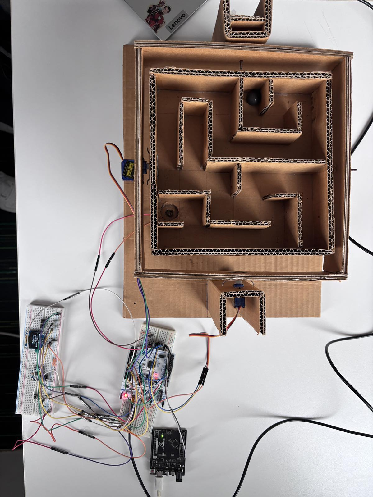
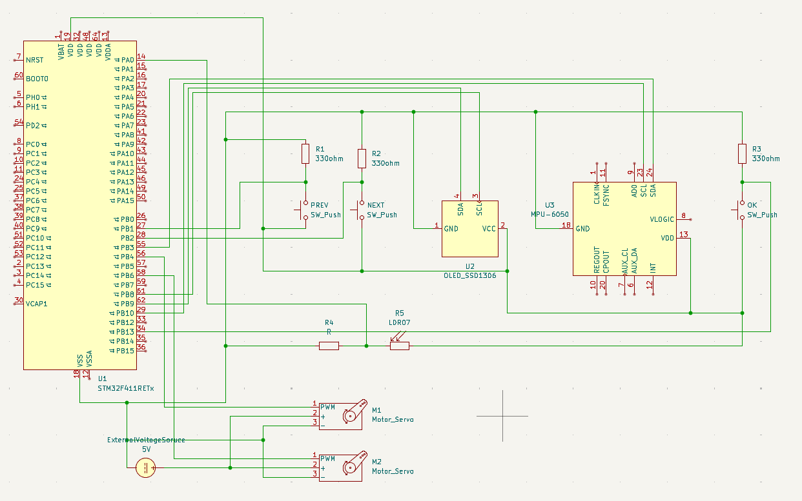
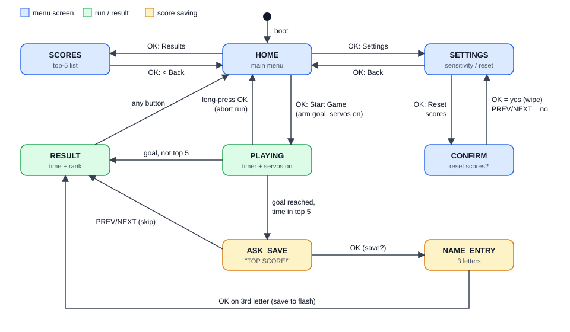

# Maze Game on STM32 Nucleo-F411RE with Zephyr RTOS

**Author:** _Berin Žunić_  

---

## 1. Introduction

This project is an embedded "maze game" built on the STM32 Nucleo-F411RE board and the Zephyr RTOS. A physical maze platform is mounted on a two-axis servo gimbal. The player tilts a motion sensor (MPU6050) and the gimbal copies the tilt, so a marble rolls through the maze. When the marble reaches the goal, a photoresistor detects it, the timer stops, and the time is compared against a persistent high-score table. The game is operated through a small OLED display and three push buttons.



*Figure 1: The finished maze game. _(Photo: whole project, OLED on, taken from above at an angle.)_*

The goals were to:

- build a complete, responsive embedded application from several independent services,
- use Zephyr's device-tree driven drivers (I2C, PWM, ADC, display, input, settings),
- keep results across power cycles using flash storage.

## 2. Hardware

| Component | Role | Interface / pins |
|---|---|---|
| STM32 Nucleo-F411RE (Cortex-M4, 96 MHz, 512 KB flash) | Main controller | – |
| MPU6050 accelerometer/gyro | Reads the player's tilt | I2C2 (PB10 SCL / PB3 SDA), 100 kHz, address 0x68 |
| SSD1306 OLED 128×64 | User interface | I2C1 (PB8 SCL / PB9 SDA), 400 kHz, address 0x3C |
| 2 × SG90-class servo | X and Y axis of the maze gimbal | TIM3_CH1 / PB4 and TIM4_CH1 / PB6 (PWM) |
| Photoresistor (LDR) + ~10 kΩ divider | Goal detection | ADC1_IN0 / PA0 |
| 3 push buttons (PREV, NEXT, OK) | Menu and game input | PB1, PB2, PB13 (active low, internal pull-up) |



*Figure 2: Wiring diagram. _(Draw in Fritzing / draw.io: Nucleo-F411RE connected to MPU6050, SSD1306, 2 servos, LDR divider and 3 buttons, with pin names.)_*

Notable hardware decisions (all in `boards/nucleo_f411re.overlay`):

- **Servo PWM:** 20 ms frame, pulse limited to 1.1–1.9 ms (slightly inside the datasheet range) to avoid buzzing at the mechanical end stops. The timer prescaler is set to 95 so the counter ticks at 1 MHz; without it a 20 ms period does not fit the timer.
- **Pin conflicts resolved in the overlay:** USART1 (shares PB6 with servo 2) and the on-board user button (shares EXTI line 13 with the OK button) are disabled.
- **ADC clock:** prescaler /4 gives 24 MHz, within the F411's 36 MHz limit; a long 480-tick acquisition time compensates for the LDR's high source impedance.
- **Flash storage:** the top two 128 KB sectors (256 KB) are reserved as `storage_partition`.

## 3. Software Architecture

The application is split into independent *services*, each with a header-defined API, plus a thin `main.c` that initialises and starts them. Services communicate through Zephyr message queues instead of calling each other directly.

```
 MPU6050 ──► Sensor service ──(k_msgq: imu_sample)──► Servo service ──► 2 × servo
                                                          ▲ set_active / sensitivity
 Buttons ──(input subsystem)──► Game service (state machine) ──► Display service ──► OLED
 LDR ───────► Goal service ──(polled)──┘            │
                                                    └──► Score service ──► flash (ZMS)
```

| Service | Source | Responsibility |
|---|---|---|
| Sensor | `services/Sensor_service` | Polls the MPU6050 every 100 ms and publishes acceleration samples. If the queue is full the oldest sample is dropped, so a slow consumer never stalls sampling. Thread priority 5. |
| Servo motor | `services/ServoMotor_service` | Maps X/Y acceleration to a PWM pulse for each servo. Can be switched on/off; when off, both servos go to neutral. Holds the persisted sensitivity setting. Thread priority 6. |
| Goal | `services/Goal_service` | Detects the marble arriving using the LDR (see 4.3). Polled by the game thread. |
| Score | `services/Score_service` | Maintains the top-5 table (3-letter name + time), saves/loads/resets it in flash. |
| Display | `services/Display_service` | Renders each game screen as a pure function of a `ui_model` using Zephyr's character framebuffer. All drawing is serialised with a mutex. |
| Game | `services/Game_service` | The main state machine; turns button presses into events and drives all other services. Thread priority 7. |

Priorities follow urgency: sampling (5) above servo output (6) above the game/UI thread (7), so the UI can never delay the control loop.

## 4. Implementation Details

### 4.1 Tilt-to-servo control

The servo thread blocks on the sensor queue. For each sample, the X acceleration drives servo 1 and the negated Y acceleration drives servo 2. Each value is normalised to 0…1 with

```
normalized = (accel + ACCEL_MAX) / (2 · ACCEL_MAX)    (clamped to 0…1)
pulse      = min_pulse + normalized · (max_pulse − min_pulse)
```

`ACCEL_MAX` is derived from the sensitivity level (1–10, default 5): `ACCEL_MAX = 11 − level` m/s². A higher level therefore reaches full servo deflection with a smaller tilt. The level is stored in an atomic variable because it is written by the game thread and read by the servo thread.

### 4.2 Game state machine

The game thread waits for events with a 100 ms timeout; the timeout doubles as the tick for the on-screen clock and the goal polling. States:

`HOME → (START) PLAYING → ASK_SAVE → NAME_ENTRY → RESULT → HOME`, with side branches `SCORES` (results list with scrolling) and `SETTINGS → CONFIRM` (sensitivity and score reset). Figure 3 shows all states and the events that trigger each transition.



*Figure 3: Game state machine. Arrows are labelled with the button event or condition that triggers the transition.*

Button handling uses Zephyr's input subsystem (`gpio-keys`). A callback measures press duration: a **short press** scrolls/selects, a **long press (≥ 500 ms)** acts as confirm/abort — for example, a long press on OK aborts a run. This lets three buttons cover all menu actions. Starting a run records the start time, arms the goal sensor and activates the servos; finishing a run latches the time, parks the servos in neutral and decides whether the result qualifies for the table.

### 4.3 Goal detection

An absolute ADC threshold would fail whenever room lighting changes, so detection is **relative**:

- A slow exponential moving average of the uncovered reading acts as the ambient *baseline*, re-seeded at the start of each run.
- The goal fires when the reading falls below **60 %** of the baseline for **3 consecutive polls**. Each poll averages 8 ADC conversions to reduce noise.
- While covered, the baseline is frozen so the marble does not corrupt it; the sensor re-arms only after the reading recovers above 80 % of the baseline (hysteresis).
- Readings pinned near the rails (< 32 or > 4063 counts) are treated as a wiring fault and never count as a goal. If the sensor fails to initialise, the game still works and a run can be ended manually with a long press on OK.

### 4.4 High-score persistence

Scores and sensitivity are stored with Zephyr's Settings subsystem. **NVS could not be used**: on this SoC its settings backend forces the sector size to the 128 KB erase block and stores it in a 16-bit field, so initialisation fails with `-EDOM`. **ZMS** (Zephyr Memory Storage) uses a 32-bit sector size and works with the 128 KB sectors, so it was chosen instead. The table holds the 5 best times, kept sorted with an insertion sort; a new result is saved only if it makes the top 5.

### 4.5 User interface

The 128×64 display fits four rows with the smallest built-in font. Screens: main menu (Start Game / Results / Settings), live timer during play, "TOP SCORE!" prompt, name entry (three letters, PREV/NEXT change the letter, OK advances), result screen with rank and current best, scrollable results list, and settings (sensitivity, reset scores with confirmation).

## 5. Configuration

Key `prj.conf` options: I2C, PWM, ADC and GPIO drivers; `MPU6050` in polled mode (no interrupt pin wired); `SSD1306` with the character framebuffer and a 4 KB heap; floating-point `printf`; `FLASH_MAP`, `SETTINGS` and `ZMS`; `INPUT_GPIO_KEYS` for the buttons.

## 6. Build and Run

```
west build -b nucleo_f411re C:\zephyrproject\project
west flash
```

Open a serial terminal on the ST-LINK virtual COM port (USART2) to see logs such as the goal baseline, sensor readiness and saved scores.

## 7. Testing and Results

- Servo response time from tilt to movement (sampling is 100 ms, so expect up to that delay).
- Goal detection reliability in dim and bright rooms (log the LDR counts and baseline with the `goal` log level set to DBG).
- Score persistence: save a score, power-cycle, confirm it is still listed.
- Behaviour with the LDR unplugged (fault warning, manual end of run).


## 8. Challenges and Solutions

| Problem | Solution |
|---|---|
| NVS settings backend fails on 128 KB sectors | Switched to ZMS |
| PB6 shared by USART1 and servo 2 TIM4_CH1 | Disabled USART1 (console uses USART2) |
| EXTI line 13 shared by user button (PC13) and OK button (PB13) | Disabled the on-board user button |
| 20 ms PWM period too long for the timer at full speed | Prescaler 95 → 1 MHz tick |
| LDR readings depend on room light | Adaptive baseline with relative threshold and hysteresis |
| Only three buttons for many actions | Short vs. long press distinction |

## 9. Possible Improvements

- Add smoothing/filtering of the accelerometer (the current mapping uses raw samples every 100 ms) and a faster sample rate.
- Use gyro data or a complementary filter for steadier tilt.
- Store more scores or add difficulty levels / different mazes.
- Add sound feedback (buzzer) on goal or new record.
- Wire the MPU6050 interrupt pin and use trigger mode instead of polling.
- Design PCB for this project

## 10. Conclusion

The project delivers a complete interactive embedded game: sensor-driven actuation, robust goal detection, a menu-driven OLED interface and persistent scores, structured as small decoupled services running in prioritised Zephyr threads. It demonstrates practical use of device-tree configuration, message queues, the input and settings subsystems, and solving real hardware constraints on the STM32F411.
